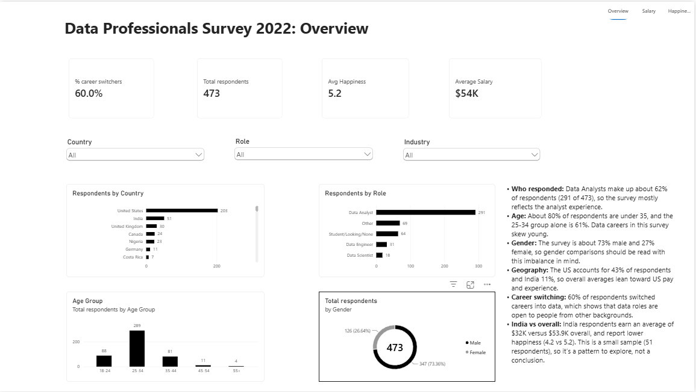
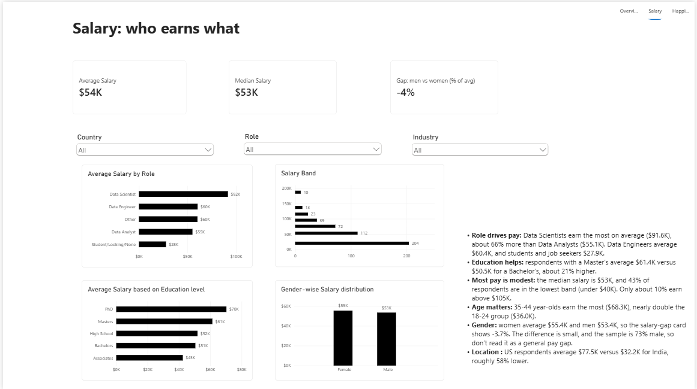
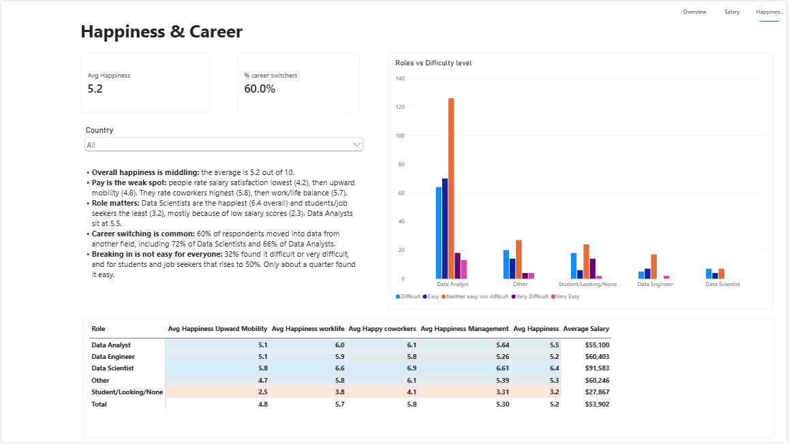

# Data Professionals Survey 2022: Power BI Dashboard

An interactive 3-page Power BI dashboard that analyses a survey of 473 data professionals: who they are, what they earn, how happy they are at work, and how hard it was to break into data.

## Dashboard preview

| Overview | Salary | Happiness & Career |
|---|---|---|
|  |  |  |

## Business questions answered

- Who responded (role, country, age, gender), and how many switched careers into data?
- What do data professionals earn, and how does pay differ by role, education, gender and country?
- How satisfied are people with salary, work/life balance, coworkers, management and growth?
- How difficult was it to break into data, and what do people prioritise in a new job?

## Key findings (all 473 respondents)

- **Role drives pay:** Data Scientists average about $91.6K, roughly 66% more than Data Analysts ($55.1K).
- **Education helps:** Master's holders average $61.4K versus $50.5K for Bachelor's, about 21% higher.
- **Pay is the weak spot:** salary satisfaction scores lowest (4.2 / 10); coworkers score highest (5.8 / 10).
- **Career switching is common:** 60% of respondents moved into data from another field.
- **Getting in is hard for many:** 32% found it difficult or very difficult (50% of students and job seekers).
- **Location matters:** US respondents average $77.5K versus $32.2K for India.

Full write-up: [docs/insights.md](docs/insights.md)

## Tools and skills

- **Power BI Desktop:** data model, report design, slicers, page navigation
- **Power Query:** data cleaning and transformation
- **DAX:** measures for averages, percentages, medians, gender gap and ranking (see [docs/dax_measures.md](docs/dax_measures.md))

## Data

- **Source:** public Data Professional Survey practice dataset (2022)
- **Size:** 630 raw responses, 473 after cleaning
- **Columns:** role, industry, country, age, gender, education, salary band, six job-satisfaction ratings, career-switch flag, difficulty of breaking in, top job priority
- **Cleaned data:** [data/data_professionals_survey_cleaned.csv](data/data_professionals_survey_cleaned.csv)
- **Field descriptions:** [docs/data_dictionary.md](docs/data_dictionary.md)

### Data preparation (Power Query)

- Removed empty and unused columns
- Standardised text (trimmed spaces, fixed spelling and capitalisation)
- Grouped free-text job titles into 5 roles: Data Analyst, Data Engineer, Data Scientist, Student/Looking/None, Other
- Converted age into bands (18-24, 25-34, 35-44, 45-54, 55+)
- Converted salary bands into numeric midpoints so averages can be calculated
- Removed incomplete responses (630 to 473 rows)

## Repository structure

```
dashboard/     Power BI file (.pbix)
data/          Cleaned dataset (.csv)
docs/          DAX measures, data dictionary, insights
screenshots/   Images of each dashboard page
```

## How to open the dashboard

1. Download the `.pbix` file from the `dashboard/` folder.
2. Open it in Power BI Desktop (free from Microsoft).
3. Use the slicers (Country, Role, Industry) and the page navigator at the top right.

## Limitations

- Self-reported 2022 survey data from a self-selected sample, so it does not represent all data professionals.
- The sample is weighted toward Data Analysts and US respondents (about 73% male), and some groups are small (for example 18 Data Scientists).
- Salaries are reported in bands, so averages use band midpoints and are approximate.

## Author

Vishnuvardhan R | Bengaluru, India | [LinkedIn](https://www.linkedin.com/in/vishnuvardhanr05/)
